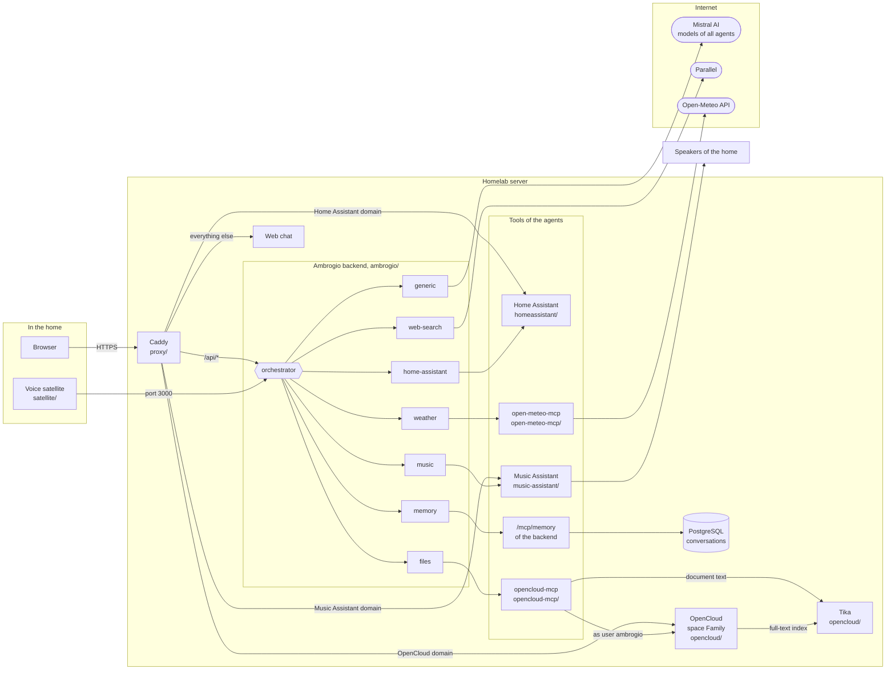

<p align="center">
  
</p>

# Ambrogio homelab example

**Ambrogio**: talk to it like Alexa, chat with it like ChatGPT. One self-hosted AI assistant for your whole homelab. Multi-agent by design: each agent you configure handles one job, such as the house, music, weather or your documents, using the services you already host.

A complete home installation of [Ambrogio](https://ambrogio-app.github.io/ambrogio-docs/), one Docker Compose
file per service, as a starting point for your own homelab:

| Folder | Runs | Where |
|---|---|---|
| `proxy/` | Caddy: `/api/*` to the backend, everything else to the web chat; OpenCloud, Home Assistant and Music Assistant on their own domains | homelab server |
| `ambrogio/` | backend, its PostgreSQL archive and the web chat | homelab server |
| `open-meteo-mcp/` | the Open-Meteo MCP server for the weather agent | homelab server |
| `opencloud/` | OpenCloud, the family's file cloud, with Apache Tika to extract the text of documents | homelab server |
| `opencloud-mcp/` | a read-only MCP server for OpenCloud, used by the files agent | homelab server |
| `homeassistant/` | Home Assistant on the host network | homelab server |
| `music-assistant/` | Music Assistant on the host network, to play the family's music on the speakers of the home | homelab server |
| `satellite/` | one voice satellite | a Raspberry Pi or another device in a room |

The agents in `ambrogio/agents/` use these services:

| Agent | Uses |
|---|---|
| `files` | the `opencloud-mcp` container, on the `homelab_mcp` network |
| `generic` | general knowledge only |
| `home-assistant` | the "Model Context Protocol Server" integration of Home Assistant |
| `memory` | the backend's own MCP server at `/mcp/memory`, to search past conversations |
| `music` | the MCP server of the FastMCP Server plugin of Music Assistant |
| `weather` | the `open-meteo-mcp` container, on the `homelab_mcp` network |
| `web-search` | the public MCP server of [Parallel](https://parallel.ai/) |

The orchestrator chooses one of them for each request. All of them use Mistral AI models; any provider of the [agent configuration](https://ambrogio-app.github.io/ambrogio-docs/reference/agent-configuration/) works.

> **This is an example, not a release.** It is not updated with every release of Ambrogio. It was written for
> backend `v0.17.0`, web chat `v0.3.1` and satellite `v0.8.1`; before using another release, read its notes in
> [Versions and compatibility](https://ambrogio-app.github.io/ambrogio-docs/reference/versions/) and adapt the
> files. The documentation is the reference for every field and variable.

## How it works



A request, typed in the web chat or spoken to a satellite, reaches the backend: the web chat through Caddy, the
satellite directly on port `3000`. The satellite turns speech into text and the answer back into speech on the
device. The orchestrator picks the agent whose description fits the request. The agent asks its Mistral AI model,
calls the tools of its MCP server as many times as it needs within `maxToolCalls`, and answers. The backend stores
every answered turn in PostgreSQL, where the memory agent can find it later.

## Start

On the homelab server, from the root of this repository:

1. Copy `.env.example` to `.env` and fill in every value.
2. Point `AMBROGIO_DOMAIN`, `OPENCLOUD_DOMAIN`, `HOME_ASSISTANT_DOMAIN` and `MUSIC_ASSISTANT_DOMAIN` to the homelab
   server in your home DNS.
3. In `ambrogio/web/config.json`, set `backendUrl` to `https://` followed by your `AMBROGIO_DOMAIN`.
4. In `ambrogio/agents/weather.json`, replace `HOME_TOWN` with the town used when nobody names a place.
   In `.env`, set `MUSIC_LIBRARY_DIR` to the folder of the music files on the homelab server.
5. Create the network the proxy shares with the services and the one of the MCP servers, then start the services in
   this order, the MCP servers before the backend. `opencloud-mcp` starts in step 9, once it has its app password.

   ```bash
   docker network create homelab_proxy
   docker network create homelab_mcp
   docker compose --env-file .env -f homeassistant/docker-compose.yml up -d
   docker compose --env-file .env -f music-assistant/docker-compose.yml up -d
   docker compose --env-file .env -f open-meteo-mcp/docker-compose.yml up -d
   docker compose --env-file .env -f opencloud/docker-compose.yml up -d
   docker compose --env-file .env -f ambrogio/docker-compose.yml up -d
   docker compose --env-file .env -f proxy/docker-compose.yml up -d
   ```

6. Let Home Assistant accept requests from the proxy, then restart it:

   ```bash
   docker exec homeassistant sh -c 'printf "\nhttp:\n  use_x_forwarded_for: true\n  trusted_proxies:\n    - 172.16.0.0/12\n" >> /config/configuration.yaml'
   docker compose --env-file .env -f homeassistant/docker-compose.yml restart
   ```

   `172.16.0.0/12` includes the Docker networks, the one of the proxy too. Open `https://` followed by your
   `HOME_ASSISTANT_DOMAIN` and create the owner account.
7. In Home Assistant, add the "Model Context Protocol Server" integration, expose to Assist the entities Ambrogio may
   use, create a long-lived access token and put it in `HOME_ASSISTANT_TOKEN`. Then restart the backend:
   `docker compose --env-file .env -f ambrogio/docker-compose.yml restart ambrogio`.
8. Prepare Music Assistant for the music agent, as described in [Music in Music Assistant](#music-in-music-assistant),
   put its token in `MUSIC_ASSISTANT_TOKEN` and restart the backend in the same way.
9. Prepare OpenCloud for the files agent, as described in [Documents in OpenCloud](#documents-in-opencloud), put the
   app password in `OPENCLOUD_MCP_APP_TOKEN`, then start `opencloud-mcp` and restart the backend:

   ```bash
   docker compose --env-file .env -f opencloud-mcp/docker-compose.yml up -d
   docker compose --env-file .env -f ambrogio/docker-compose.yml restart ambrogio
   ```

The backend connects to the MCP server of each agent once, right after it starts listening. An agent whose server
does not answer stays unavailable until the backend restarts, with an `agent_mcp_unavailable` line in its log: start
Home Assistant, Music Assistant and the MCP servers before the backend, or restart the backend once they are up.

Caddy issues the certificates from its own local
authority: install Caddy's root certificate, `/data/caddy/pki/authorities/local/root.crt` in the `caddy-data`
volume, on the family's devices, or replace `tls internal` in `proxy/Caddyfile` with a certificate for a public domain.

## Documents in OpenCloud

The `files` agent searches and reads the family's documents, such as bills, contracts and payslips, and answers
with a link to each document it used. It goes through
[opencloud-mcp](https://github.com/adrianofoschi/opencloud-mcp), an independent MCP server that is not part of
Ambrogio, with two read-only tools: `search_files`, which searches names and the text Tika extracted, and
`read_file`, which returns the text of one file.

The server logs in as an OpenCloud user named `ambrogio`, which sees only what is shared with it. Put the documents
for Ambrogio in one space:

1. Sign in to `https://` followed by your `OPENCLOUD_DOMAIN` as `admin`, with `OPENCLOUD_ADMIN_PASSWORD`.
2. In the user management, create the user `ambrogio` and the accounts of the family.
3. Create a space, for example "Family", add the family as members who can edit and `ambrogio` with the role
   **Can view**. Copy the documents into it: OpenCloud copies files between spaces, it does not move them.
4. Create an app password for `ambrogio`. It cannot be created without an expiry, so the example gives it 100 years:

   ```bash
   docker exec opencloud opencloud auth-app create --user-name=ambrogio --expiration=876000h
   ```

   The command prints `token:` followed by several words separated by spaces: the whole phrase is the password. In
   `.env`, write it in single quotes.

The text of a new document becomes searchable once Tika has indexed it, usually within a minute.

## Music in Music Assistant

The `music` agent searches the family's music library and plays it on the speakers of the home: tracks, albums,
artists and playlists, with pause, resume, stop, next track, volume and favorites. It uses the MCP server of
Music Assistant's [FastMCP Server](https://music-assistant.io/plugins/fastmcp-server/) plugin, which runs on the
same port as its web interface. Music Assistant runs on the host network, like Home Assistant, to discover the
players and stream to them.

1. Open `https://` followed by your `MUSIC_ASSISTANT_DOMAIN` and create the administrator account.
2. In **Settings → Music providers**, add **Local Files** with the folder `/music`: it is `MUSIC_LIBRARY_DIR`,
   mounted read-only. New files appear after the next scan of the library.
3. In **Settings → Players**, add the speakers of the home, for example with a player provider such as
   [Squeezelite](https://www.music-assistant.io/player-support/squeezelite/).
4. In **Settings → Plugins**, add **FastMCP Server** and keep **Require authentication** on.
5. In your profile, under **Long-lived access tokens**, create a token for Ambrogio and put it in
   `MUSIC_ASSISTANT_TOKEN`.

The agent finds a player by the name you give it in Music Assistant: name the players after the rooms, so that the
family can say where to play.

## Satellite

Copy `satellite/` to the device in the room, copy `satellite.env.example` to `satellite.env`, set
`AMBROGIO_BACKEND_URL` to port `3000` of the homelab server and give each satellite its own `AMBROGIO_CLIENT_ID`
and `AMBROGIO_CLIENT_NAME`. Then `docker compose up -d` on the device. Microphone, speaker and wake word are set with
the variables of the [satellite configuration](https://ambrogio-app.github.io/ambrogio-docs/reference/satellite-configuration/).

## What stays private

The backend has no accounts: anyone who reaches it can talk to it. Keep port `3000` and the domain inside the home
network, or behind a VPN. Home Assistant and Music Assistant also answer on ports `8123` and `8095` of the
homelab server, because they run on the host network: keep those inside the home network as well. `/mcp/memory` is not forwarded by the proxy.

Whatever the user `ambrogio` can read in OpenCloud, anyone in the family can read by asking Ambrogio, and the
links in its answers open for every member of the space. Keep personal documents out of the space. The text the
files agent reads is sent to the provider of its model. The app password works like a permanent credential:
revoke it in OpenCloud if it leaks. The data live in Docker volumes: back up
`ambrogio-database` with `pg_dump`, `homeassistant-config` as Home Assistant explains, `music-assistant-data` with Music Assistant stopped, and `opencloud-config` and
`opencloud-data` with OpenCloud stopped. Never commit `.env` or
`satellite.env`.

## Checks

`scripts/check` validates every compose file with the variables of `.env.example`, parses the JSON files and loads
the agents with the backend release named in `.env.example`. CI runs it on every pull request, together with a scan
for secrets. Enable the pre-commit hook in each clone with `git config core.hooksPath .githooks`; it needs
`gitleaks` on `PATH`.

## License

MIT, like Ambrogio.
